<div align="center">

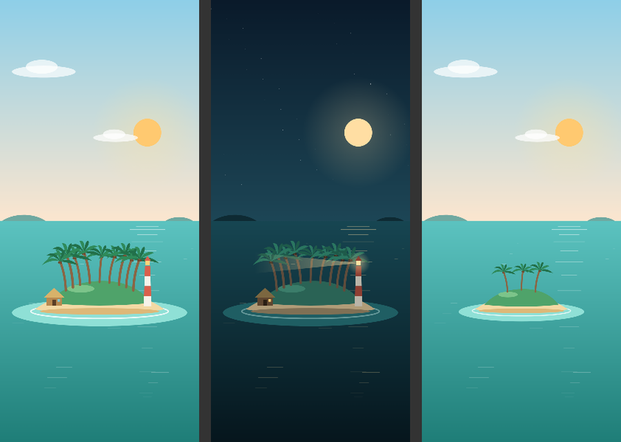

# 🏝️ Focus Island

**Concentrez-vous, révisez, et regardez votre île grandir.**

Minuteur Pomodoro, cartes de révision, examens et défis, réunis dans une app Android pensée pour les étudiants.
Chaque session de concentration terminée plante un palmier sur votre île.

*A focus timer, study cards and exam planner for Android, where every finished session grows your own island.*

Android 8.0+ · Français / English · Thème clair et sombre

</div>

---

## Sommaire

- [L'idée](#lidée)
- [Fonctionnalités](#fonctionnalités)
- [Captures d'écran](#captures-décran)
- [Installer l'app](#installer-lapp)
- [Confidentialité](#confidentialité)
- [Pour les développeurs](#pour-les-développeurs)

## L'idée

Réviser longtemps est plus facile quand on voit ses efforts s'accumuler. Dans Focus Island :

- chaque session terminée **plante un palmier** ;
- l'île **grandit** au fil des sessions, avec une cabane à 12 sessions et un phare à 25 ;
- le ciel suit **l'heure réelle** : soleil le jour, lune et phare allumé la nuit ;
- vos amis ont aussi leur île, et toutes forment un **archipel** que vous pouvez explorer.

## Fonctionnalités

### ⏱️ Focus
- Minuteur Pomodoro (focus, pause courte, pause longue) avec cycles et points de progression.
- **Cadran de 24 h** autour du minuteur : vos sessions de la journée apparaissent à l'heure où vous les avez faites.
- **Mode Focus** plein écran, sur fond noir pour économiser la batterie : grand chronomètre, luminosité réglable, protection contre le marquage des écrans OLED. L'écran reste allumé pendant la session.
- **Sons** : stations de radio du monde entier et ambiances (pluie, ruisseau, feu de camp, bruit blanc, espace). Le dernier son utilisé reste à portée de main.
- **Ne pas déranger** automatique pendant le focus, et **blocage d'apps** : les apps choisies sont bloquées, ou leurs notifications coupées, jusqu'à la fin de la session.

### 🏆 Défis
- Un objectif et une limite de temps, par exemple « Réviser 30 cartes en 30 min ».
- Compte à rebours de 5 secondes avec bips, notification avec le temps restant, **confettis** si vous réussissez avant la fin.
- Historique et taux de réussite.

### 📚 Étude
- **Cartes de révision** : texte, tableaux, listes, surlignage et cartes vocales.
- **Scanner de documents** : détection automatique des bords de la page, redressement et nettoyage.
- **Lecture du texte** sur l'appareil. Avec une clé Gemini gratuite (facultative), l'app lit aussi l'écriture manuscrite, les tableaux et les formules, et choisit automatiquement le meilleur modèle disponible.
- Sauvegarde et import des cartes (`.json`), synchronisation dans le cloud avec un compte, rappel de révision quotidien.

### 📈 Progrès
- Statistiques : temps de focus, points, sessions et série de jours.
- **Examens** avec compte à rebours.

### 🌊 Communauté
- **Classement** entre tous les utilisateurs : points, temps, sessions ou série.
- **Amis** et **archipel** sans fin : faites glisser pour explorer, pincez pour zoomer, touchez une île pour voir le profil.
- Partage facultatif de la radio que vous écoutez.

### 🎨 Styles
Quatre looks complets au choix dans **Réglages → Apparence → Style**. Chacun change les couleurs, les polices, les formes, l'île, la fête et le son de réussite :
- **Lagoon** : calme et sobre (le style d'origine) ;
- **Night Arcade** : néon et jeux vidéo, atoll cyber, « LEVEL UP » ;
- **Blossom** : pastel et fleuri, île aux cerisiers, pluie de pétales ;
- **Little Explorer** : pour les enfants, île au trésor, tortue mascotte et textes encourageants.

Le style est purement visuel : fonctions et données sont les mêmes partout.

<p align="center">
  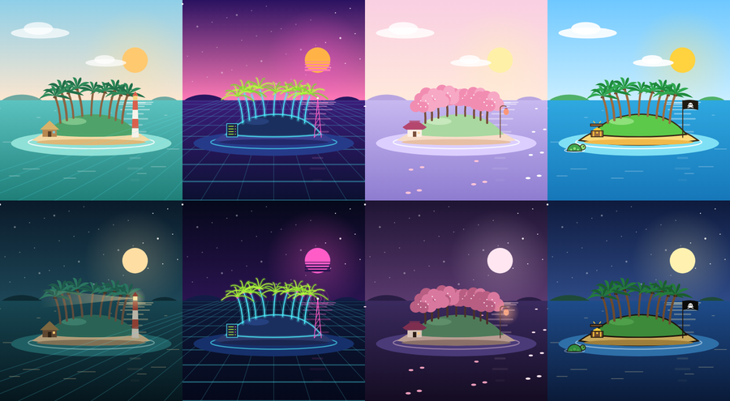
</p>
<p align="center">
  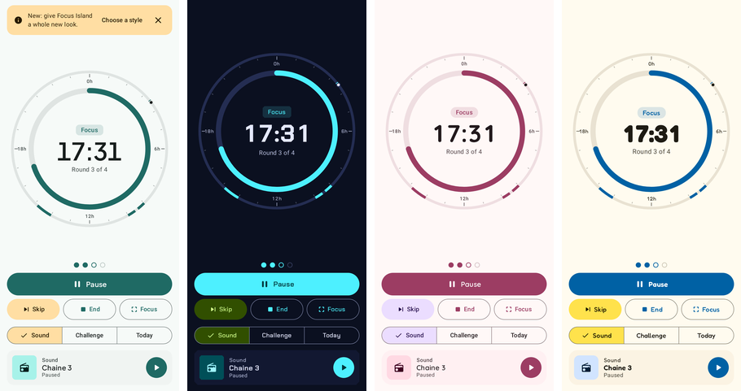
</p>

### 📱 Widgets et fond d'écran
- Widget **Compte à rebours** : prochain examen, deux suivants et vos statistiques de focus.
- Widget **Année** : une pastille par jour, vos examens entourés et la progression de l'année.
- Pensés pour les lanceurs Samsung, Xiaomi, Huawei et les autres, en clair et en sombre, aux couleurs de votre style.
- Votre île en **fond d'écran**, fixe ou animé.

## Captures d'écran

<table>
  <tr>
    <td align="center">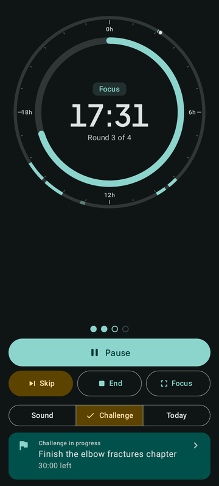<br/><sub>Focus et cadran de la journée</sub></td>
    <td align="center">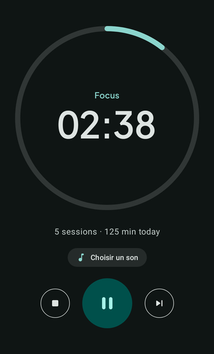<br/><sub>Mode Focus</sub></td>
    <td align="center">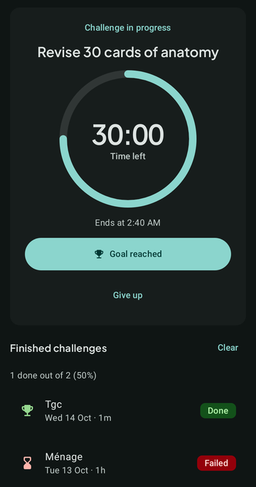<br/><sub>Défi en cours</sub></td>
  </tr>
</table>

<table>
  <tr>
    <td align="center">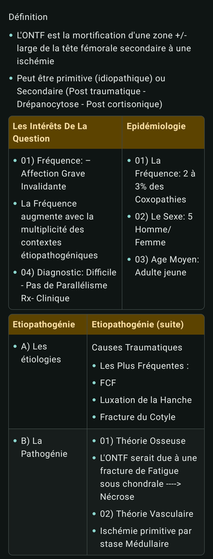<br/><sub>Carte de révision scannée</sub></td>
    <td align="center">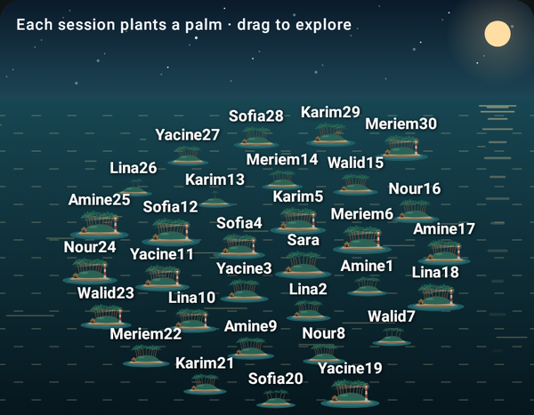<br/><sub>L'archipel de vos amis</sub></td>
  </tr>
</table>

<table>
  <tr>
    <td align="center">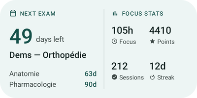<br/><sub>Widget Compte à rebours</sub></td>
    <td align="center">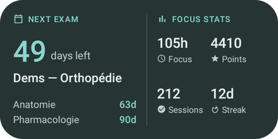<br/><sub>En thème sombre</sub></td>
  </tr>
  <tr>
    <td align="center" colspan="2">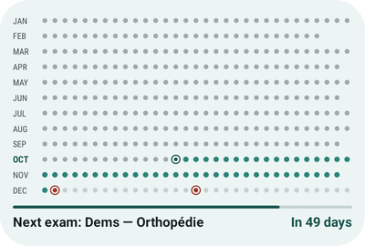<br/><sub>Widget Année</sub></td>
  </tr>
</table>

## Installer l'app

Focus Island n'est pas sur le Play Store. Elle s'installe à partir de l'APK :

1. Ouvrez l'onglet **Actions** de ce dépôt, puis le dernier build avec une coche verte.
2. Dans **Artifacts**, téléchargez **FocusIsland-&lt;version&gt;-APK**, puis dézippez-le.
3. Ouvrez `FocusIsland-<version>.apk` sur votre téléphone et autorisez l'installation.

Si Play Protect affiche un avertissement, choisissez **Plus de détails → Installer quand même**. C'est le cas pour toute app installée hors du Play Store par un développeur que Google ne connaît pas encore.

## Confidentialité

- Vos cartes, sessions et examens restent **sur votre téléphone**. Seuls la synchronisation des cartes (si vous êtes connecté) et le profil de classement passent par Firebase.
- La clé Gemini est **chiffrée sur le téléphone** et ne sert qu'à appeler Google.
- Les accès sensibles (« Ne pas déranger », utilisation des apps, affichage par-dessus les autres apps) ne servent qu'au mode Focus et au blocage d'apps, et ne sont demandés que si vous activez ces fonctions.

## Pour les développeurs

<details>
<summary>Technologies, compilation et publication</summary>

**Technologies** : Kotlin, Jetpack Compose, Material 3, Room, WorkManager, Media3, Firebase (Auth, Firestore), ML Kit (reconnaissance de texte, scanner de documents), Coil. Polices des styles : Plus Jakarta Sans, Chakra Petch, Quicksand et Fredoka (SIL Open Font License, voir [`licenses/`](licenses/)).

**Widgets par style** : les mises en page des widgets de chaque style sont générées par `scripts/gen_widget_styles.py` à partir de celles de Lagoon. Modifiez l'original, puis relancez le script.

**Compiler en local** : JDK 17 et Android SDK 35, puis

```bash
./gradlew :app:assembleDebug        # APK de debug
./gradlew :app:testDebugUnitTest    # tests unitaires
```

**Build signé** : le workflow GitHub Actions (`.github/workflows/build-and-sign.yml`) lance les tests, compile la version release (R8), puis signe l'APK et l'App Bundle. Il a besoin de quatre secrets : `KEYSTORE_BASE64`, `RELEASE_ALIAS`, `RELEASE_KEY_PASSWORD` et `RELEASE_SIGNING_PASSWORD`. La procédure de publication est décrite dans [`RELEASE.md`](RELEASE.md).

Ne mettez jamais le fichier `.jks` ni les mots de passe dans le dépôt.

</details>

---

<div align="center">
Créé par <b>Youcef Merah</b>, chirurgien orthopédiste de métier, programmeur de cœur.
</div>
